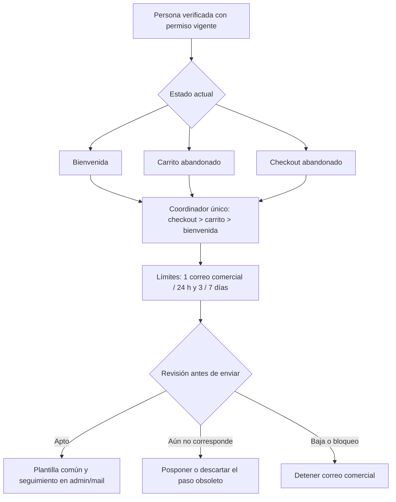

# Cómo funciona la malla de correo

Corte de publicación: 23 de noviembre de 2026. Alcance comercial activo: `recovery_welcome`.

Los plazos se cuentan desde el evento que abre cada recorrido y son mínimos,
sujetos a prioridad, pertinencia y frecuencia:

| Recorrido | Plazos de referencia |
|---|---|
| Bienvenida | Inicio, +3, +5, +8 y +12 días |
| Carrito | +4 y +24 horas |
| Checkout | +1, +24 y +72 horas |

La recuperación requiere actividad reciente registrada y los permisos aplicables,
incluido el analítico. Una compra cancela la recuperación correspondiente. La
bienvenida editorial puede seguir siendo pertinente después de comprar; sus
ofertas convertidas se omiten. Los pasos atrasados no se acumulan para enviarse
todos juntos.

Los mensajes de servicio (cuenta, pedido y pago) mantienen su circuito separado.
Las automatizaciones por visitas o interés en producto y las de posventa y
fidelización permanecen apagadas. La ventana por zona horaria y los experimentos
A/B siguen como propuestas.

El plano A0 y el anexo literal se reproducen con los scripts descritos en
[CRM-REVIEW-ARTIFACTS.md](CRM-REVIEW-ARTIFACTS.md). El plano diferencia
implementación activa, funciones apagadas y propuestas.
